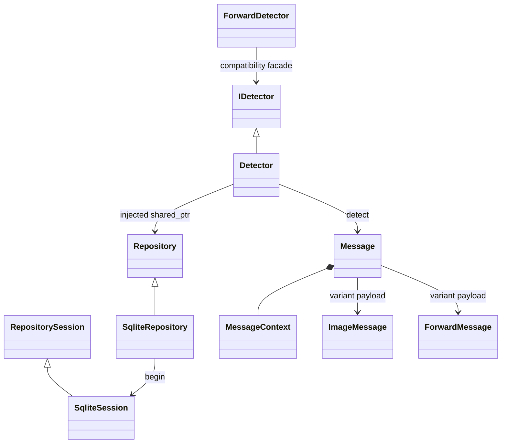

# 统一检测接口、仓储与消息指纹

图片和合并转发包通过 `Message` 进入同一个 `IDetector.detect()`。`Detector` 编排查重策略，`Repository` 提供存储接口，`SqliteRepository` 实现事务、索引和持久化。`ImageMessage` 与 `ForwardMessage` 是独立值类型，用 `std::variant` 表达消息种类。



`MessageContext` 保存群作用域、消息 ID、发送者和分段序号。`ImageMessage` 保存 RGB 像素；`ForwardMessage` 仅保存最外层资源命名空间、资源 ID 和可见卡片文本。消息类型没有包内节点字段，核心和插件均不调用 `get_forward_msg`、下载整包或递归读取正文和图片。

## 每条消息都有哈希

所有 `Detection` 都返回 `fingerprint`，包括算法 `sha256`、版本 `1`、种类、依据和 64 位小写十六进制值。便利属性为 `message_hash` 和 `hash_basis`。两类消息共用算法、编码和索引，但哈希依据应当随结果一起读取。

| `hash_basis` | 输入字段 | 用途 |
|---|---|---|
| `decoded_pixels` | 图片原有的尺寸 + RGB SHA-256 | 精确像素身份；改图仍需 SIFT 几何匹配 |
| `forward_resource` | 资源命名空间、顶层资源 ID | 同一顶层资源引用再次出现 |
| `visible_card` | 规范化可见卡片文本的 SHA-256 | 弱证据，只能返回“可能同卡片” |
| `occurrence` | 群作用域、消息 ID、分段序号 | 缺少可比资料时识别事件重推，不用于跨事件判重 |

规范编码为 UTF-8：`huoxing.message.v1|<kind>:<basis>|`，随后按顺序追加每个字段的 `<UTF-8字节数>:<字段>|`，最后对整体计算 SHA-256。长度前缀避免字段包含分隔符而产生歧义，类型和依据避免不同消息域混淆。除事件依据外，发送者、群号、外层消息 ID 和接收时间不进入身份哈希；查询始终按群隔离。

统一哈希可以由本项目计算；OneBot 的消息 ID 或转发资源 ID 并没有承诺是跨转发稳定的内容哈希。只允许读取整包顶层时，如果资源 ID 变化、卡片信息又不足，就无法证明两个包的内部内容相同。此时返回证据不足。参考 [OneBot 消息段](https://github.com/botuniverse/onebot-11/blob/master/message/segment.md) 和 [公开 API](https://github.com/botuniverse/onebot-11/blob/master/api/public.md)。

## Python 调用

```python
from huoxing import Detector, ForwardMessage, ImageMessage, Message, MessageContext

detector = Detector("data/huoxing.sqlite")
with open("meme.png", "rb") as image:
    result = detector.detect(Message(
        MessageContext("qq:bot:group", "100", "alice"),
        ImageMessage(image.read(8 * 1024 * 1024 + 1)),
    ))
print(result.message_hash, result.hash_basis, result.duplicate)

result = detector.detect(Message(
    MessageContext("qq:bot:group", "101", "bob"),
    ForwardMessage("onebot11:forward-id", "outer-resource-id"),
))
print(result.status, result.message_hash)
```

同步接口需要在宿主工作线程中调用。既有的 `Detector.ingest()`、`ForwardDetector.ingest()`、异步 `ImageWorker` 和插件调用仍可使用；它们进入同一个原生检测流程。自动提醒仅针对可靠重复，卡片弱证据默认不提醒。

## C++ 注入接口

```cpp
import std;
import huoxing;
import huoxing.repository_sqlite;

auto repository = std::make_shared<huoxing::SqliteRepository>("huoxing.sqlite");
std::shared_ptr<huoxing::IDetector> detector =
    std::make_shared<huoxing::Detector>(repository);
auto result = detector->detect(huoxing::Message{
    {"qq:bot:group", "101", "bob", 0},
    huoxing::ForwardMessage{"onebot11:forward-id", "outer-resource-id", ""}
});
```

其他后端实现 `Repository` 与 `RepositorySession` 即可注入。会话必须保证重推查询、身份查询、候选遍历、登记和提交在一次原子事务中完成；未提交时析构回滚。图片特征提取在开启写事务之前完成。SQLite 会话通过同一个连接调用图片和转发存储模块。

## 数据兼容

`message_hashes(scope, kind, digest, basis, storage_id, sender_id)` 是新增的统一索引。既有 `images`、`occurrences`、`forward_occurrences` 保留，图片特征格式不变。遇到尚未建立统一索引的旧数据时，先用原有索引查询，再把统一索引指向首次记录。

重推结果从已存的原始身份重建哈希，调用方重试时传来不同载荷也不会改变已登记身份。旧版转发记录未保存发送者，无法恢复时返回空值。容量异常同时回滚消息和统一索引；`delete_scope()` 在同一事务中清理两种消息及所有指纹索引。
